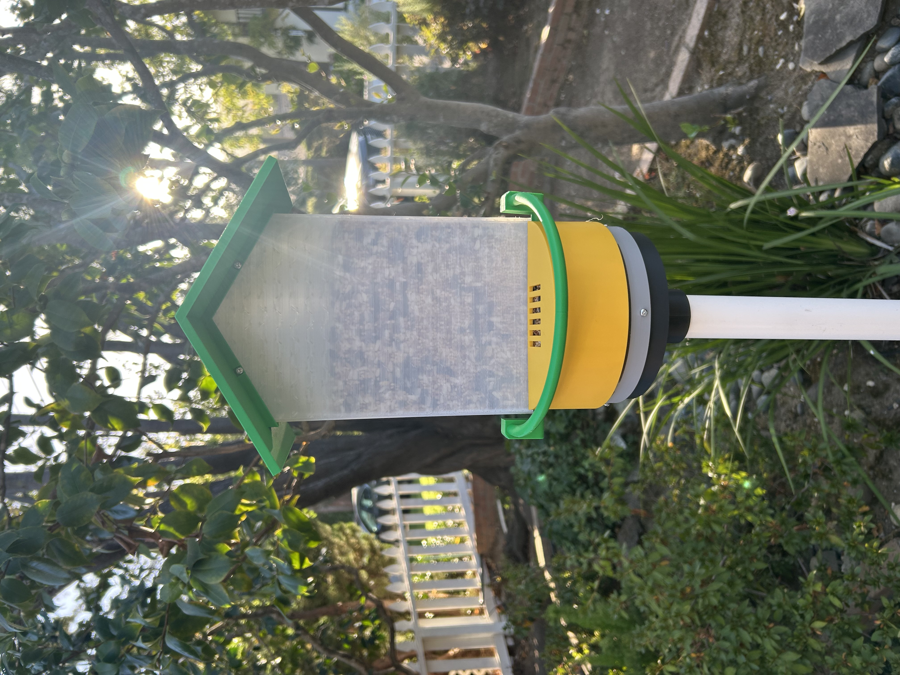

# Smart birdfeeder

Mechanical CAD for the feeder, plus a local copy of the hatch **controller**.

The controller is maintained at **[olivia-dicorpo/birdfeeder-ctlr](https://github.com/olivia-dicorpo/birdfeeder-ctlr)** (Tiny Tapeout Verilog). Edit and CI live there. `controller/` here is that project so CAD and firmware can be read together.



Prototype in the yard: green roof, clear hopper, yellow tray, detection-arm hoop, pole mount.

Videos: [IMG_1682.mov](media/IMG_1682.mov) · [IMG_1683.MOV](media/IMG_1683.MOV)

## Controller

A single detection-arm switch runs **open 3 s → hold while the arm is closed → wait 10 s → close 3 s**. Re-trip during the wait restarts it; trip during close reopens. An SG90 **continuous-rotation** servo is driven at 50 Hz (stop 1.5 ms, open 1.0 ms, close 2.0 ms).

| | |
|--|--|
| Repo | [github.com/olivia-dicorpo/birdfeeder-ctlr](https://github.com/olivia-dicorpo/birdfeeder-ctlr) |
| Top | `tt_um_olivia_dicorpo_birdfeeder` |
| Clock | 10 MHz |
| Author | Olivia DiCorpo (Apache-2.0) |
| Local tree | [`controller/`](controller/README.md) |
| Notes | [`docs/controller.md`](docs/controller.md) |

Simulate from that repo (or this copy):

```sh
cd controller/test
make -B
```

## CAD

Open `cad/fusion/birdfeeder-corrected.f3z` in Fusion 360. Later STEP parts are in `cad/step/`. See [`docs/hardware.md`](docs/hardware.md).

## Photos and video

| File | What |
|------|------|
| [`media/IMG_1682.jpg`](media/IMG_1682.jpg) | Still of the assembled feeder (JPEG from the HEIC) |
| [`media/IMG_1682.heic`](media/IMG_1682.heic) | Original still |
| [`media/IMG_1682.mov`](media/IMG_1682.mov) | Short clip |
| [`media/IMG_1683.MOV`](media/IMG_1683.MOV) | Longer clip |
